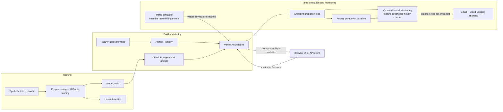

# Churn Prediction & Model Monitoring

This project demonstrates how a tabular machine-learning model moves from training to a monitored online service. It trains an XGBoost model to estimate whether a telco customer may churn, serves predictions through a FastAPI endpoint, and demonstrates how production inputs can shift over time.

The example generates synthetic telco data, so it runs without a private or downloaded customer dataset. The data is for demonstrating the pipeline only; its model scores do not describe real customers.

## What the project does

1. Generate synthetic customer records with features like contract type, tenure, monthly charges, and support services. A synthetic `Churn` label is the training target.
2. Fit preprocessing and an XGBoost classifier, then save the pipeline and holdout metrics.
3. Serve a customer record over HTTP and return its churn probability and a binary prediction.
4. Package the FastAPI service in Docker and deploy it to a Vertex AI Endpoint.
5. Send baseline traffic followed by a month of gradually shifted inputs. Vertex AI Model Monitoring checks production feature distributions and can alert when a drift threshold is exceeded.

In short, the pipeline is:

```text
Synthetic training data -> XGBoost + preprocessing -> model.joblib + metrics + baseline CSV
FastAPI + model.joblib -> Docker -> Artifact Registry -> Vertex AI Endpoint
                                                       -> online prediction logs
                                                       -> Vertex Model Monitoring v1
                                                       -> email + Cloud Logging alert
Traffic simulator -> 30 virtual days of baseline or shifting inputs -> Endpoint
```

Vertex Model Monitoring v1 is used because it is the generally available endpoint monitoring workflow. Drift mode compares production input distributions over time; training-serving skew is a separate mode that requires the training dataset. The monitoring schedule supports a minimum one-hour interval, so the simulator compresses 30 virtual days into a burst by default. Its optional sleep setting can spread requests over real elapsed time.

## System diagram



The endpoint is the REST service that clients call. In the simulated flow, the monitor compares a new request window with a recent production baseline and reports a feature anomaly when a configured threshold is crossed.

## Project layout

```text
src/churn_monitoring/
  data.py                 Synthetic train and traffic data
  schema.py               Shared feature contract
  train.py                Fit model and write metrics/artifacts
  serve.py                FastAPI Vertex-compatible prediction server
  static/index.html       Browser form for local and container predictions
  simulate_traffic.py     Send virtual-month traffic to an endpoint
scripts/
  deploy_vertex.ps1       Build, push, upload, and deploy
  configure_monitoring.ps1 Create hourly drift monitoring and alerts
  cleanup_vertex.ps1      Remove endpoint and model resources
examples/
  predict_request.json    Monitoring schema sample and prediction example
```

## Train locally

Requires Python 3.11+ and [uv](https://docs.astral.sh/uv/getting-started/installation/). Run from the repository root in PowerShell:

```powershell
$env:UV_PROJECT_ENVIRONMENT = ".venv-churn-monitoring"
uv sync --python 3.11
uv run python -m churn_monitoring.train --rows 8000 --seed 42
```

This sets uv's project environment directory to `.venv-churn-monitoring`; `uv sync` creates it if needed, resolves the dependencies, and creates `uv.lock` on the first run. Commit `uv.lock` so future syncs use the same resolved versions. The environment variable applies to the current PowerShell session, so set it again in each new terminal before running `uv sync` or `uv run`. You can activate it with `.\.venv-churn-monitoring\Scripts\Activate.ps1`, or use `uv run` as above without activating.

The command creates `artifacts/model/model.joblib` (preprocessing plus classifier), `artifacts/training_baseline.csv` (training rows including `Churn`), and `artifacts/metrics.json` (holdout ROC AUC, accuracy, precision, recall, F1, and counts).

## Run the API locally

```powershell
$env:UV_PROJECT_ENVIRONMENT = ".venv-churn-monitoring"
$env:MODEL_PATH = "artifacts/model/model.joblib"
uv run uvicorn churn_monitoring.serve:app --host 127.0.0.1 --port 8080
```

Open [http://127.0.0.1:8080](http://127.0.0.1:8080) for the browser interface. Enter customer details and select **Predict churn risk** to see the score and prediction. The interface sends requests to the same `POST /predict` API used by the deployment. FastAPI's interactive API page remains at [http://127.0.0.1:8080/docs](http://127.0.0.1:8080/docs), ReDoc is at [http://127.0.0.1:8080/redoc](http://127.0.0.1:8080/redoc), and the health check is at [http://127.0.0.1:8080/health](http://127.0.0.1:8080/health).

In another terminal:

```powershell
Invoke-RestMethod -Method Post -Uri http://127.0.0.1:8080/predict `
  -ContentType "application/json" `
  -InFile examples/predict_request.json
```

The API returns `churn_probability` and `churn_prediction` for each instance. `/predict` accepts Vertex AI's standard `{"instances": [...]}` payload. In Vertex, the container reads model artifacts from `AIP_STORAGE_URI`; locally, `MODEL_PATH` selects the artifact.

To inspect the training results, open `artifacts/metrics.json`. After deployment, use the Vertex AI Endpoints and Model Monitoring pages in Google Cloud Console to inspect the service and monitoring job. Drift anomaly emails and Cloud Logging entries show when thresholds are exceeded.

## Deploy to Vertex AI

Prerequisites: a Google Cloud project with billing enabled; `gcloud` and Docker installed; permission to enable APIs, create Artifact Registry and Cloud Storage resources, upload models, create endpoints, and deploy endpoint replicas. Log in to gcloud and Application Default Credentials before running the simulator.

Train first, then run in PowerShell with a globally unique bucket name:

```powershell
.\scripts\deploy_vertex.ps1 `
  -ProjectId YOUR_PROJECT_ID `
  -Region us-central1 `
  -BucketName YOUR_UNIQUE_BUCKET_NAME
```

The script enables APIs, creates the repository and bucket when absent, builds and pushes the image, uploads the model artifact, creates an endpoint, and deploys one `e2-standard-2` replica. It prints the endpoint and model IDs. Vertex endpoints incur charges while deployed; clean them up when finished.

Create the hourly drift monitor using the endpoint ID:

```powershell
.\scripts\configure_monitoring.ps1 `
  -ProjectId YOUR_PROJECT_ID `
  -Region us-central1 `
  -EndpointId YOUR_ENDPOINT_ID `
  -AlertEmail you@example.com
```

By default, the job monitors `tenure`, `MonthlyCharges`, `TotalCharges`, `Contract`, `InternetService`, and `PaymentMethod` at a distance threshold of `0.1`. Adjust it with `-Threshold`. Anomaly emails and Cloud Logging anomaly entries are enabled; all prediction requests are sampled by default (`-SamplingRate 1.0`).

## Simulate 30 days of traffic

First send a baseline month:

```powershell
$env:UV_PROJECT_ENVIRONMENT = ".venv-churn-monitoring"
uv run python -m churn_monitoring.simulate_traffic `
  --project YOUR_PROJECT_ID --region us-central1 --endpoint-id YOUR_ENDPOINT_ID `
  --phase baseline
```

Let one scheduled monitoring interval complete with baseline traffic. Then send a virtual month that gradually shifts the input mix:

```powershell
$env:UV_PROJECT_ENVIRONMENT = ".venv-churn-monitoring"
uv run python -m churn_monitoring.simulate_traffic `
  --project YOUR_PROJECT_ID --region us-central1 --endpoint-id YOUR_ENDPOINT_ID `
  --phase drift
```

Each phase sends one request per virtual day with 50 records per request. Drift increases month-to-month contracts, fiber service, electronic-check payments, short-tenure customers, and monthly charges. The next scheduled run compares the new production window with the recent baseline and emails an alert if a feature distance exceeds its threshold. A fast simulation cannot produce a separate Vertex monitoring result for every virtual day because the service runs at least hourly.

To space requests in real time, set a delay between virtual days. For example, `--sleep-seconds 3600` takes about 29 hours per phase; `86400` approximates one request day per real day.

## Cleanup

Stop and delete the monitor first. Its ID is printed by `configure_monitoring.ps1` (or use `gcloud ai model-monitoring-jobs list --project YOUR_PROJECT_ID --region us-central1`):

```powershell
gcloud ai model-monitoring-jobs pause MONITORING_JOB_ID --project YOUR_PROJECT_ID --region us-central1
gcloud ai model-monitoring-jobs delete MONITORING_JOB_ID --project YOUR_PROJECT_ID --region us-central1
```

Then remove the endpoint and model:

```powershell
.\scripts\cleanup_vertex.ps1 `
  -ProjectId YOUR_PROJECT_ID -Region us-central1 `
  -EndpointId YOUR_ENDPOINT_ID -ModelId YOUR_MODEL_ID
```

The cleanup script leaves Artifact Registry and the Cloud Storage bucket in place for inspection or reuse. Remove those separately if no longer needed.

## Notes

- Review licensing, privacy, and schema requirements before substituting real training data.
- Tune the example threshold against representative production windows to control alert noise.
- Drift is a data quality signal, not proof that model quality has degraded. Evaluate delayed outcomes such as realized churn too.

## Google Cloud references

- [Vertex AI Model Monitoring overview](https://cloud.google.com/vertex-ai/docs/model-monitoring/overview)
- [Monitor feature skew and drift](https://cloud.google.com/vertex-ai/docs/model-monitoring/using-model-monitoring)
- [Create a monitoring job with gcloud](https://cloud.google.com/sdk/gcloud/reference/ai/model-monitoring-jobs/create)
- [Use a custom container for inference](https://cloud.google.com/vertex-ai/docs/predictions/use-custom-container)
- [Custom container requirements and `AIP_STORAGE_URI`](https://cloud.google.com/vertex-ai/docs/predictions/custom-container-requirements)

